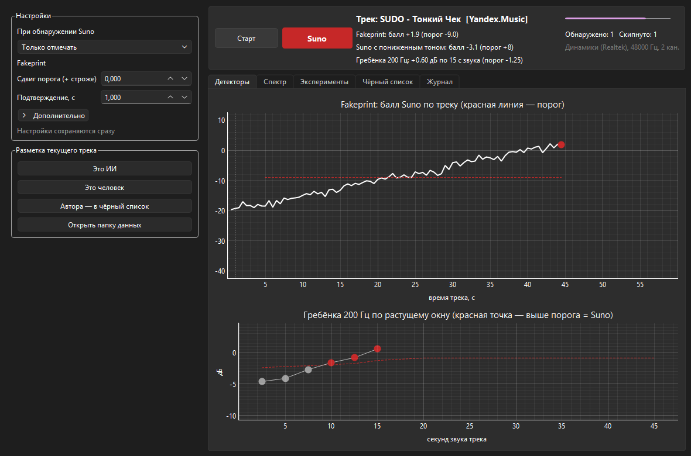

<p align="center">
  
</p>

<h1 align="center">SunoCheck</h1>

<p align="center"><b>AI music detection</b> — spots Suno-generated music in whatever your computer is playing, and can skip it.</p>

<p align="center">
  <a href="https://github.com/moonzlo/SunoCheck/releases/latest"></a>
  <a href="https://github.com/moonzlo/SunoCheck/releases"></a>
  <a href="https://github.com/moonzlo/SunoCheck/actions/workflows/ci.yml"></a>
  <a href="https://github.com/moonzlo/SunoCheck/actions/workflows/release.yml"></a>
  <a href="#verifying-the-exe"></a>
  <a href="https://github.com/moonzlo/SunoCheck/attestations"></a>
  <br>
  
  
  <a href="LICENSE"></a>
  <a href="https://github.com/astral-sh/ruff"></a>
  <a href="https://github.com/astral-sh/uv"></a>
</p>

<p align="center"><a href="README.md">Русский</a> · <b>English</b></p>

---

Streaming services are filling up with generated tracks posing as real artists. SunoCheck listens to Windows system audio (any player works: Yandex Music, Spotify, a browser) and recognises Suno by the generator's artifacts in the spectrum. A detected track gets a notification or is skipped to the next one.

- **Works with any player.** Audio comes from the system output (WASAPI loopback); no service integration.
- **Fully local.** No network, no accounts; audio never leaves your machine.
- **Explains itself.** You see which detector fired, its score and its threshold.
- **Learns from you.** An artist caught once goes to a blacklist, and their next tracks are flagged within the first second.

The interface is in Russian.



## How it works

Suno's neural decoder leaves traces that a live recording does not have. SunoCheck looks for them with three independent detectors; a track is flagged when at least one of them is confident.

| Detector | Looks for | Fires when |
|---|---|---|
| **Fakeprint** | Narrow peaks in the 1–8 kHz mean spectrum; logistic regression over 3585 features, weights from [lofcz/ai-music-detector](https://github.com/lofcz/ai-music-detector) | The logit stays ≥ +10 for 1 s. Above the threshold curve but below +10 only means "suspected" |
| **200 Hz comb** | Suno decodes in 5 ms frames, which leaves phase-stable lines at exactly k·200 Hz. One long FFT over the first 2.5–45 s of audio makes them narrow and tall | Line contrast exceeds the threshold at any checkpoint |
| **Pitch-shifted Suno** | Tracks lowered by 1–3 semitones before release to hide the artifacts. The spectrum is stretched back and a dedicated model looks for the smeared peak pattern | The score stays ≥ +8 for 1 s |

The [artist blacklist](#artist-blacklist) works on top of the audio detectors.

Track states: **Listening** → **Suspected** → **Suno**; a "Suno" verdict is final for the track. A new track starts when the Windows media session reports new metadata or after a gap of silence.

## Requirements

- Windows 10 or 11.
- Only to run from source: [uv](https://docs.astral.sh/uv/) (installs Python 3.12 by itself).
- An output device at 44.1 or 48 kHz. The comb needs lines up to 15.8 kHz, so the app stops with an error below 33.2 kHz.
- For track names and skipping: a player that reports what is playing to Windows (media session) and obeys media keys. Yandex Music, Spotify, browsers and most players do.

## Installation

### Ready-made exe

Download **[SunoCheck.exe](https://github.com/moonzlo/SunoCheck/releases/latest/download/SunoCheck.exe)** from the [latest release](https://github.com/moonzlo/SunoCheck/releases/latest), put it in any folder you can write to (for example `Documents\SunoCheck`) and run it. Nothing to install: the app keeps its data in a `data` folder next to the exe.

The exe is not code-signed, so on first launch SmartScreen may say "Windows protected your PC": click "More info" → "Run anyway". You can check the file is genuine first, see [Verifying the exe](#verifying-the-exe).

### From source

```powershell
git clone https://github.com/moonzlo/SunoCheck.git
cd SunoCheck
uv sync
```

## Verifying the exe

Every release is built by GitHub Actions from a tag of this repository ([release.yml](.github/workflows/release.yml)), not on anyone's machine. The build goes through three checks, all reported in the release notes:

- **VirusTotal.** The exe is uploaded to [VirusTotal](https://www.virustotal.com/) before publishing; the release notes show the detection count and a link to the full report. If VirusTotal does not finish the analysis, the release is not published.
- **SHA-256 checksum** in the release notes and in `SHA256SUMS.txt`. Compare it with the hash of your download:

  ```powershell
  (Get-FileHash .\SunoCheck.exe -Algorithm SHA256).Hash
  ```

- **Build attestation.** GitHub signs the link "file ↔ commit ↔ workflow". To verify (needs [GitHub CLI](https://cli.github.com/)):

  ```powershell
  gh attestation verify .\SunoCheck.exe --repo moonzlo/SunoCheck
  ```

Some antivirus engines occasionally flag PyInstaller-built programs because their unpacker resembles malware packers. If in doubt, run from source.

## Usage

### Window with charts

Run `SunoCheck.exe` or, from source:

```powershell
uv run sunocheck-gui
```

Press **Старт** (Start) and play music. Closing the window keeps the app in the tray: click the icon to open the panel, right-click for the menu (mode, labels, exit). The dot on the icon shows the status: green — listening, yellow — suspected, red — Suno, blue — silence, grey — stopped.

Mode, in the settings on the left:

- **Только отмечать** (log only, default) — a notification with the reason.
- **Скипать** (skip) — the app presses the "next track" media key.

The **«Это ИИ» / «Это человек»** (AI / human) buttons store your label for the current track. Labels feed the metric comparison and drive the blacklist.

### Console

```powershell
uv run sunocheck listen               # listen and print decisions
uv run sunocheck listen --mode skip   # listen and skip
uv run sunocheck analyze <files or folders>   # score audio files
uv run sunocheck --help
```

## Artist blacklist

Many generator "factories" publish dozens of tracks made the same way, some with hidden artifacts that take 10–45 s to catch by sound. The blacklist only needs to catch an artist once.

- **Added** when one of their tracks is marked with «Это ИИ» or «Автора — в чёрный список» (blacklist the artist), or when the app has skipped it.
- **Effect:** a track by a blacklisted artist is flagged on its first evaluation (about 1 s) and skipped in skip mode.
- **Removed** with «Это человек» on any of their tracks, or with «Убрать из списка» on the blacklist tab.
- **Guard:** right after a skip the blacklist does not fire while the player still reports the skipped track, so late metadata cannot skip the next track by someone else.

Details (in Russian): [docs/blacklist.md](docs/blacklist.md).

## Settings

Saved immediately to `%APPDATA%\SunoCheck\settings.json`; only values that differ from the defaults are stored.

| Setting | Default | Meaning |
|---|---|---|
| On Suno detection | log only | or skip |
| Threshold offset | 0 | Positive is stricter: fewer false positives, later detection |
| Confirmation, s | 1 | How long a confident score must hold |
| First evaluation after, s | 1 | Audio needed before the first evaluation |
| Evaluation interval, s | 0.064 | How often the fakeprint is recomputed |
| Track buffer, s | 60 | How many recent seconds count |
| Silence threshold, dBFS | −50 | Quieter is silence |
| Silence = new track, s | 0.4 | Gap that starts a new track |
| Pause after skip, s | 3 | Audio ignored after a skip |
| Save track recordings (WAV) | on | Last seconds of each track are kept for review |

## Data

`data/` is created next to `SunoCheck.exe`, or, when running from source, in the folder you start the app from. It stays on your machine.

| Path | Contents |
|---|---|
| `data/recordings/` | WAV of the last seconds of each track (turn off with "Save track recordings") |
| `data/sessions/` | CSV of every evaluation: detector scores, thresholds, status |
| `data/labels.csv` | Your AI / human labels |
| `data/blacklist.csv` | Blacklist journal |

## Accuracy and limitations

Research corpus: 280 Suno v2–v5.5 tracks and 722 human tracks from FMA and MTG-Jamendo, cross-validated by track. TPR is the share of Suno caught at a given false positive rate on humans (FPR).

| Detector, window | Variant | AUROC | TPR at 1 % FPR | TPR at 0.1 % FPR |
|---|---|---|---|---|
| Fakeprint, 10 s | original and codecs | 0.9996 | 0.993 | — |
| 200 Hz comb, 10 s | original | 1.000 | 1.00 | 0.96 |
| 200 Hz comb, 10 s | AAC 128 | 0.999 | 0.99 | 0.91 |

Live thresholds are stricter than in the table: flagging a real artist is worse than a miss. A Suno track is usually detected in 5–20 s, a blacklisted artist in about 1 s, a pitch-shifted track in up to 45 s.

Limitations:

- **Suno only.** Other generators (Udio etc.) were not tested.
- **Processing hurts.** Speed changes, pitch-up and heavy reverb (slowed + reverb) weaken the traces. Pitch-down by 1–3 semitones has its own model; pitch-up cannot be undone in the 16 kHz stream.
- **Dense modern pop** sometimes lifts the fakeprint to "suspected"; a "Suno" verdict needs a much higher score.
- **The blacklist is metadata-based.** A false skip blacklists a real artist; check the tab and fix it with «Это человек».
- **Windows only** (WASAPI capture, Windows media session).

This is an assistant, not forensic evidence: do not use its verdict against a specific artist.

## Development

```powershell
uv sync --all-groups      # + pytest, ruff and research dependencies
uv run pytest             # pure-logic tests (decision, blacklist, settings, fakeprint)
uv run ruff check src tests tools packaging .github/scripts
uv run --group build pyinstaller packaging/sunocheck.spec --noconfirm   # dist\SunoCheck.exe
```

Every push and pull request to `main` runs [CI](.github/workflows/ci.yml): lint, tests and an exe build (kept as an artifact for 14 days).

Releasing:

1. Bump `version` in `pyproject.toml` and move the `[Unreleased]` changes into a new `CHANGELOG.md` section.
2. Commit and tag the same version:

   ```powershell
   git tag v0.2.0
   git push origin main v0.2.0
   ```

[release.yml](.github/workflows/release.yml) checks the tag against the version and CHANGELOG, builds the exe, scans it on VirusTotal and publishes a release with notes from CHANGELOG.

| Path | Contents |
|---|---|
| `src/sunocheck/` | the app: capture (`capture.py`), detectors (`fakeprint.py`, `coherent_comb.py`), decision (`decision.py`), loop (`listener.py`), window (`gui.py`), console (`cli.py`) |
| `src/sunocheck/models/` | fakeprint model weights |
| `tests/` | pytest |
| `tools/` | GUI smoke test with screenshots, responsiveness probe, decision replay over recordings |
| `research/` | detector research (in Russian) |
| `docs/` | feature docs (in Russian) |
| `packaging/` | exe build (PyInstaller) |
| `.github/` | CI, release, VirusTotal and release-notes scripts |

The code is functional: pure functions and frozen dataclasses, classes only for external systems (audio capture, media session, window). Errors are not masked by fallbacks; they stop with a clear message.

## Research

[research/](research/) documents how the detectors were found: corpus, experiments and a log of every tested hypothesis with numbers, rejected ones included (in Russian). Start with [research/REPORT.md](research/REPORT.md); [research/README.md](research/README.md) explains how to rebuild the corpus.

## License and credits

[MIT](LICENSE).

- Fakeprint weights: [lofcz/ai-music-detector](https://github.com/lofcz/ai-music-detector) by Matěj Štágl, MIT ([LICENSE-lofcz.txt](src/sunocheck/models/LICENSE-lofcz.txt)).
- Research corpus: [Kukedlc/suno-ai-music-dataset](https://huggingface.co/datasets/Kukedlc/suno-ai-music-dataset), [FMA](https://github.com/mdeff/fma), [MTG-Jamendo](https://mtg.github.io/mtg-jamendo-dataset/).
- UI: [PySide6](https://doc.qt.io/qtforpython-6/) (LGPL) and [pyqtgraph](https://www.pyqtgraph.org/); audio capture: [PyAudioWPatch](https://github.com/s0d3s/PyAudioWPatch).
- `SunoCheck.exe` bundles these libraries, Python and Qt under their own licenses (Qt and PySide6: LGPL v3). The [Development](#development) section shows how to build the exe with other versions of them.

SunoCheck is not affiliated with Suno, Inc. Suno is a trademark of its owner.
