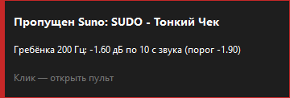
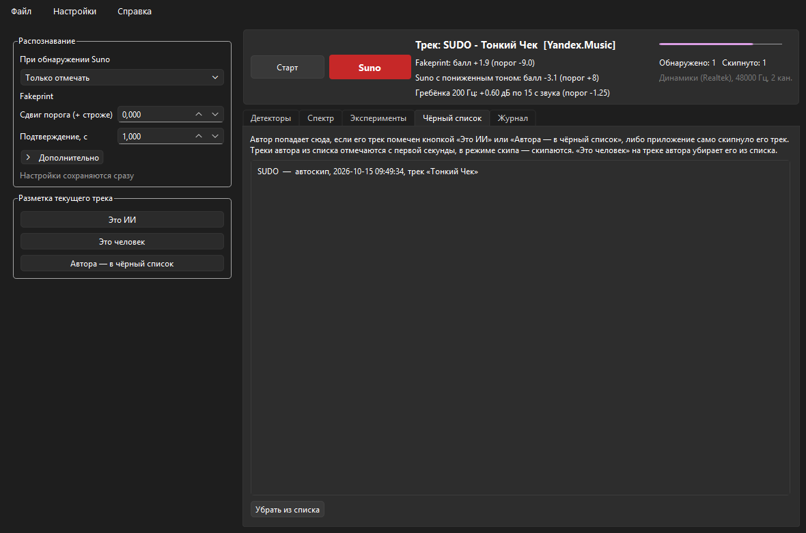

<p align="center">
  
</p>

<h1 align="center">SunoCheck</h1>

<p align="center"><b>AI music detection</b> — распознаёт музыку, сгенерированную Suno, прямо в звуке, который играет ваш компьютер, и по желанию пропускает её.</p>

<p align="center">
  <a href="https://github.com/moonzlo/SunoCheck/releases/latest"></a>
  <a href="https://github.com/moonzlo/SunoCheck/releases"></a>
  <a href="https://github.com/moonzlo/SunoCheck/actions/workflows/ci.yml"></a>
  <a href="https://github.com/moonzlo/SunoCheck/actions/workflows/release.yml"></a>
  <a href="#проверка-exe"></a>
  <a href="https://github.com/moonzlo/SunoCheck/attestations"></a>
  <br>
  
  
  <a href="LICENSE"></a>
  <a href="https://github.com/astral-sh/ruff"></a>
  <a href="https://github.com/astral-sh/uv"></a>
</p>

<p align="center"><b>Русский</b> · <a href="README.en.md">English</a></p>

---

Стриминги всё больше заполняются сгенерированными треками под видом живых исполнителей. SunoCheck слушает системный звук Windows (подходит любой плеер: Яндекс Музыка, Spotify, браузер) и по артефактам генератора в спектре определяет, сделан ли трек в Suno. Найденный трек приложение отмечает уведомлением или сразу переключает на следующий.

- **Работает с любым плеером.** Звук берётся из системного вывода (WASAPI loopback), к сервисам не нужно подключаться.
- **Всё локально.** Нет сети, нет аккаунтов, звук никуда не отправляется.
- **Объясняет решение.** На экране видно, какой детектор сработал, с каким баллом и при каком пороге.
- **Учится у вас.** Автор, однажды пойманный на Suno, попадает в чёрный список, и его следующие треки отмечаются с первой секунды.


## Содержание

- [Как это работает](#как-это-работает)
- [Требования](#требования)
- [Установка](#установка)
- [Проверка exe](#проверка-exe)
- [Использование](#использование)
- [Чёрный список авторов](#чёрный-список-авторов)
- [Настройки](#настройки)
- [Где лежат данные](#где-лежат-данные)
- [Точность и ограничения](#точность-и-ограничения)
- [Разработка](#разработка)
- [Исследование](#исследование)
- [Лицензия и благодарности](#лицензия-и-благодарности)

## Как это работает

Нейросетевой декодер Suno оставляет в звуке следы, которых нет в живой записи. SunoCheck ищет их пятью независимыми детекторами. Трек считается сгенерированным, если уверенно сработал хотя бы один.

| Детектор | Что ищет | Когда срабатывает |
|---|---|---|
| **Fakeprint** | Узкие пики в среднем спектре 1–8 кГц. Логистическая регрессия на 3585 признаках, веса из [lofcz/ai-music-detector](https://github.com/lofcz/ai-music-detector) | Балл (логит) ≥ +10 держится 1 с. Балл выше пороговой кривой, но ниже +10, даёт только статус «Подозрение» |
| **Гребёнка 200 Гц** | Декодер Suno работает кадрами по 5 мс, поэтому в спектре появляются фазово-стабильные линии около k·200 Гц. Одно длинное БПФ по первым 1–180 с звука; мелкий рассинхрон часов компенсируется поиском по ±150 ppm | Контраст линий выше порога в любой контрольной точке (с ~1–2.5 с на сильном Suno) |
| **Suno с пониженным тоном** | Треки, которые перед публикацией понизили на 1–3 полутона (ресемпл), чтобы спрятать артефакты. Спектр «растягивается» обратно, и отдельная модель ищет размытый рисунок пиков | Балл ≥ +8 держится 1 с, либо балл ≥ +2 стоит острым пиком ровно на полутоне (на 0,2–2 % в сторону ниже минимум на 5). Та же модель без отмены сдвига ловит слабый обычный Suno: балл ≥ +8 держится 1 с |
| **Фабрики −1 st (WSOLA)** | Понижение ровно на полутон без сдвига частоты дискретизации (WSOLA): обычная гребёнка и 16 кГц fakeprint слепнут. Отдельная модель на 1–14 кГц @ 32 кГц | Балл ≥ 0 и контраст к соседним коэффициентам ≥ 2 |
| **Замедленный Suno** | Треки, замедленные на 2–20 % пересэмплированием. Пики артефактов целы, но сдвинуты; fakeprint перебирает коэффициент замедления | Балл ≥ +6 стоит острым пиком на одном коэффициенте (на 0,2–2 % в сторону ниже минимум на 6) 1 с |

Поверх звуковых детекторов работает [чёрный список авторов](#чёрный-список-авторов).

Состояния трека: **Слушаю** → **Подозрение** → **Suno**. После вердикта «Suno» трек не пересматривается. Новый трек определяется по смене метаданных в медиасессии Windows или по паузе тишины.

## Требования

- Windows 10 или 11.
- Только для запуска из исходников: [uv](https://docs.astral.sh/uv/) (сам поставит Python 3.12).
- Устройство вывода с частотой 44.1 или 48 кГц. Гребёнке нужны линии до 15.8 кГц, поэтому при частоте ниже 33.2 кГц приложение остановится с ошибкой.
- Для названий треков и для скипа — плеер, который сообщает Windows, что играет (медиасессия), и слушается мультимедийных клавиш. Так делают Яндекс Музыка, Spotify, браузеры и большинство плееров.

## Установка

### Установщик (рекомендуется)

Скачайте **[SunoCheck-Setup.exe](https://github.com/moonzlo/SunoCheck/releases/latest/download/SunoCheck-Setup.exe)** из [последнего релиза](https://github.com/moonzlo/SunoCheck/releases/latest) и запустите. Права администратора не нужны: программа ставится в `%LOCALAPPDATA%\Programs\SunoCheck`, ярлык появляется в «Пуске», удаляется SunoCheck через «Параметры → Приложения». Для обновления установите новую версию поверх старой: настройки, данные и чёрный список сохранятся.

### Портативная версия

**[SunoCheck-Portable.exe](https://github.com/moonzlo/SunoCheck/releases/latest/download/SunoCheck-Portable.exe)** — один файл без установки. Положите его в папку, куда у вас есть права на запись (например, `Документы\SunoCheck`): данные программа хранит в папке `data` рядом с ним. Каждый запуск занимает 10–20 с, потому что файл распаковывает себя во временную папку; установленная версия стартует за пару секунд.

Файлы не подписаны сертификатом, поэтому при первом запуске SmartScreen может показать «Windows защитила ваш компьютер»: нажмите «Подробнее» → «Выполнить в любом случае». Перед этим можно убедиться, что файл настоящий, см. [Проверка exe](#проверка-exe).

### Из исходников

```powershell
git clone https://github.com/moonzlo/SunoCheck.git
cd SunoCheck
uv sync
```

## Проверка exe

Каждый релиз собирается GitHub Actions из тега этого репозитория ([release.yml](.github/workflows/release.yml)), без участия чьего-либо компьютера. Сборка проходит три проверки, их результаты есть в описании релиза:

- **VirusTotal.** Установщик и портативный exe загружаются на [VirusTotal](https://www.virustotal.com/) до публикации; в описании релиза — число срабатываний и ссылка на полный отчёт по каждому. Если VirusTotal не успел проверить файл, релиз не публикуется.
- **Контрольная сумма SHA-256** — в описании релиза и в файле `SHA256SUMS.txt`. Сравните с хешем скачанного файла:

  ```powershell
  (Get-FileHash .\SunoCheck-Setup.exe -Algorithm SHA256).Hash
  ```

- **Аттестация сборки.** GitHub подписывает связь «файл ↔ коммит ↔ workflow». Проверка (нужен [GitHub CLI](https://cli.github.com/)):

  ```powershell
  gh attestation verify .\SunoCheck-Setup.exe --repo moonzlo/SunoCheck
  ```

Отдельные антивирусы иногда помечают программы, собранные PyInstaller: их распаковщик похож на упаковщики вредоносного ПО. Если сомневаетесь, запускайте из исходников.

## Использование

### Окно с графиками

Запустите SunoCheck из «Пуска» (или `SunoCheck-Portable.exe`), а из исходников так:

```powershell
uv run sunocheck-gui
```

Нажмите **Старт** и включите музыку. При закрытии окно сворачивается в трей: клик по значку открывает пульт, правый клик — меню (режим, разметка, уведомления, выход). Цвет точки на значке показывает статус: зелёный — слушаю, жёлтый — подозрение, красный — Suno, синий — тишина, серый — остановлен. SunoCheck запускается в одном экземпляре: повторный запуск открывает уже работающее окно.

Звук берётся с устройства вывода по умолчанию. Если переключить наушники и колонки, захват сам перейдёт на новое устройство. Если устройство захватить нельзя (например, гарнитура в режиме звонка с частотой 16 кГц), об этом скажут уведомление и подпись под индикатором уровня; захват возобновится, когда вы выберете другое устройство.

Меню окна:

- **Файл** — открыть папку данных, выход (Ctrl+Q).
- **Вид** — показать или скрыть боковую панель (Ctrl+B); свёрнутая панель оставляет язычок у левого края.
- **Настройки** — поведение программы, см. [Настройки](#настройки).
- **Справка** — как это работает, проверить обновления (открывает страницу релизов; сама программа в сеть не ходит), сообщить о проблеме (GitHub Issues с версией программы; приложите журнал `data/logs/sunocheck.log`), написать автору в Telegram, о программе.

Режим выбирается слева, в группе «Распознавание» (кнопка «Сбросить настройки» возвращает пороги и режим к значениям по умолчанию):

- **Только отмечать** (по умолчанию) — уведомление с причиной.
- **Скипать** — приложение нажимает мультимедийную клавишу «Следующий трек».
- **Скипать и добавлять автора в ЧС** — то же, и автор скипнутого трека сразу попадает в [чёрный список](#чёрный-список-авторов): его следующие треки скипаются с первой секунды.

<p align="center"></p>

Кнопки **«Это ИИ» / «Это человек»** под «Распознаванием» сохраняют вашу разметку текущего трека. Она нужна для сравнения метрик (вкладка «Эксперименты») и управляет чёрным списком.

Вкладки пульта:

- **Детекторы** — балл fakeprint по времени трека с пороговой кривой и точки гребёнки.
- **Спектр** — отпечаток fakeprint и остаточная спектрограмма.
- **Эксперименты** — ритм-метрики и сравнение метрик по вашей разметке (нужны записи треков, они включаются в «Дополнительно»). На решение они не влияют.
- **Чёрный список** — авторы из списка.
- **Журнал** — все события.

### Консоль

```powershell
uv run sunocheck listen               # слушать и печатать решения
uv run sunocheck listen --mode skip   # слушать, скипать и добавлять автора в ЧС (skip_only — без ЧС)
uv run sunocheck analyze <файлы или папки>   # проверить аудиофайлы
uv run sunocheck --help
```

## Чёрный список авторов

Многие генераторные «фабрики» выпускают десятки треков, сделанных одинаково, и часть из них прячет артефакты. По звуку такой трек иногда ловится только через 10–45 с. Чёрный список решает это иначе: автора достаточно поймать один раз.

- **Попадает в список**, если его трек отмечен кнопкой «Это ИИ» или «Автора — в чёрный список», либо приложение скипнуло его в режиме «Скипать и добавлять автора в ЧС».
- **Действует так:** трек автора из списка получает статус «Suno» на первой оценке, примерно через 1 с, а в режимах скипа сразу пропускается.
- **Убирается** кнопкой «Это человек» на любом его треке или кнопкой «Убрать из списка» на вкладке.
- **Защита:** после скипа список не срабатывает, пока плеер всё ещё показывает скипнутый трек. Иначе запоздалые метаданные скипнули бы следующий трек другого автора.

Подробная логика, формат файла и риски описаны в [docs/blacklist.md](docs/blacklist.md).



## Настройки

Сохраняются сразу в `%APPDATA%\SunoCheck\settings.json`; в файл пишутся только значения, отличные от стандартных.

Меню **Настройки** — поведение программы:

| Настройка | По умолчанию | Смысл |
|---|---|---|
| Показывать уведомления | вкл. | Всплывающие окна об обнаружении и скипе. Дублируется в меню трея |
| Слушать сразу после запуска | выкл. | Не нужно нажимать «Старт» |
| Запускать вместе с Windows | выкл. | Установленная и портативная версии: при входе в Windows программа стартует в трее и сразу слушает. Хранится в реестре (`HKCU\…\Run`), а не в `settings.json`; удаление программы убирает и его. Если переместить портативный exe, включите заново |

Группа **Распознавание** слева — как искать Suno:

| Настройка | По умолчанию | Смысл |
|---|---|---|
| При обнаружении Suno | Только отмечать | Или «Скипать», или «Скипать и добавлять автора в ЧС» |
| Сдвиг порога | 0 | Плюс — строже: меньше ложных срабатываний и «Подозрений», позже обнаружение |
| Подтверждение, с | 1 | Сколько секунд уверенный балл должен держаться |
| Первая оценка через, с | 1 | Сколько звука нужно до первой оценки |
| Интервал оценки, с | 0.064 | Как часто пересчитывается fakeprint |
| Буфер трека, с | 180 | Сколько последних секунд трека учитывается (нужно для длинных точек гребёнки) |
| Порог тишины, dBFS | −50 | Тише — считается тишиной |
| Тишина = новый трек, с | 0.4 | Пауза, после которой начинается новый трек |
| Пауза после скипа, с | 3 | Звук после скипа игнорируется |
| Сохранять записи треков (WAV) | выкл. | До «Буфер трека» секунд каждого трека в `data/recordings`, для «Сравнить метрики». Записывается любой звук, в том числе звонки и видео |
| Сохранять журнал оценок (CSV) | выкл. | Каждая оценка в `data/sessions`, около 9 МБ за час прослушивания |

## Где лежат данные

Папка `data/` создаётся рядом с exe: у установленной версии это `%LOCALAPPDATA%\Programs\SunoCheck\data`, у портативной — папка, где лежит файл, а при запуске из исходников — каталог, из которого запущено приложение. Всё в ней остаётся на вашем компьютере; удаление программы её не стирает.

| Путь | Что |
|---|---|
| `data/logs/` | Журнал работы и ошибок `sunocheck.log`, не больше 4 МБ: старые части удаляются сами. Приложите его к сообщению о проблеме |
| `data/recordings/` | WAV каждого трека, если включено «Сохранять записи треков» |
| `data/sessions/` | CSV всех оценок за сеанс (баллы детекторов, пороги, статус), если включено «Сохранять журнал оценок» |
| `data/labels.csv` | Ваша разметка «Это ИИ» / «Это человек» |
| `data/blacklist.csv` | Журнал чёрного списка |

## Точность и ограничения

Цифры на исследовательском корпусе: 280 треков Suno v2–v5.5 и 722 трека людей из FMA и MTG-Jamendo, перекрёстная проверка по трекам. TPR — доля пойманного Suno при заданной доле ложных срабатываний на людях (FPR).

| Детектор, окно | Вариант | AUROC | TPR при FPR 1 % | TPR при FPR 0.1 % |
|---|---|---|---|---|
| Fakeprint, 10 с | оригинал и кодеки | 0.9996 | 0.993 | — |
| Гребёнка 200 Гц, 10 с | оригинал | 1.000 | 1.00 | 0.96 |
| Гребёнка 200 Гц, 10 с | AAC 128 | 0.999 | 0.99 | 0.91 |

В реальной работе пороги выставлены строже, чем в таблице: ложное срабатывание на живом треке хуже пропуска. Обычно трек Suno обнаруживается за 2.5–20 с (гребёнка часто раньше fakeprint), трек автора из чёрного списка — примерно за 1 с, трек с пониженным тоном (ресемпл) — обычно за 8–13 с, WSOLA −1 st — когда накопится окно фабрики (~9–15 с).

Ограничения:

- **Только Suno.** На других генераторах (Udio и т. д.) не проверялось.
- **Обработка мешает.** Ускорение, повышение тона, сильная реверберация (slowed + reverb) ослабляют признаки. Понижение тона на 1–3 полутона ресемплом ловит отдельная модель, WSOLA −1 st — фабричный детектор, замедление на 2–20 % без реверберации — перебор коэффициента; ускорение и повышение тона в потоке 16 кГц отменить нельзя. Часть фабричных треков (Dust&Harmony, Phase Syndicate, Jernblod) пока проходит мимо всех детекторов.
- **Плотный современный поп** иногда поднимает fakeprint до статуса «Подозрение». Вердикт «Suno» для этого требует балла намного выше; кривая «Подозрения» поднята под живой Яндекс (меньше ложных оранжевых статусов).
- **Чёрный список работает по метаданным.** Ложный скип вносит в список живого автора; проверяйте вкладку и исправляйте кнопкой «Это человек». Из браузера названия часто не приходят (пустой SMTC) — тогда ЧС по автору недоступен.
- **Только Windows**: захват звука WASAPI и медиасессия Windows.

Это вспомогательный инструмент, а не экспертиза: не используйте его вердикт как доказательство против конкретного автора.

## Разработка

```powershell
uv sync --all-groups      # + pytest, ruff и зависимости исследования
uv run pytest             # тесты чистой логики (решение, чёрный список, настройки, fakeprint)
uv run ruff check src tests tools packaging .github/scripts
uv run pyright
uv run --group build pyinstaller packaging/sunocheck.spec --noconfirm   # dist\SunoCheck-Portable.exe и dist\SunoCheck\
& "${env:ProgramFiles(x86)}\Inno Setup 6\ISCC.exe" "/DAppVersion=$(uv version --short)" packaging\sunocheck.iss   # dist\SunoCheck-Setup.exe
```

Каждый push и pull request в `main` проходит [CI](.github/workflows/ci.yml): линтер, проверка типов, тесты, сборка установщика и портативного exe (артефакт хранится 14 дней).

Выпуск релиза:

1. Поднять `version` в `pyproject.toml` и перенести изменения из `[Unreleased]` в новый раздел `CHANGELOG.md`.
2. Закоммитить и поставить тег той же версии:

   ```powershell
   git tag v0.4.0
   git push origin main v0.4.0
   ```

[release.yml](.github/workflows/release.yml) сверит тег с версией и CHANGELOG, соберёт exe, проверит его на VirusTotal и опубликует релиз с описанием из CHANGELOG.

Структура:

| Путь | Что |
|---|---|
| `src/sunocheck/` | приложение: захват (`capture.py`), детекторы (`fakeprint.py`, `coherent_comb.py`, `factory_fakeprint.py`), решение (`decision.py`), цикл (`listener.py`), окно (`gui.py`), консоль (`cli.py`) |
| `src/sunocheck/models/` | веса моделей fakeprint и фабрик |
| `tests/` | pytest |
| `tools/` | инструменты: смоук-тест окна со снимками, замер отзывчивости, повтор решения по записям |
| `research/` | исследование детекторов |
| `docs/` | документация функций |
| `packaging/` | сборка exe (PyInstaller) и установщика (Inno Setup) |
| `.github/` | CI, релиз, скрипты VirusTotal и описания релиза |

Код написан в функциональном стиле: чистые функции и неизменяемые dataclass; классы только для внешних систем (захват звука, медиасессия, окно). Ошибки не маскируются запасными путями, а останавливают работу с понятным сообщением.

## Исследование

В [research/](research/) лежит, как найдены детекторы: корпус, эксперименты и журнал всех проверенных гипотез с цифрами, включая отвергнутые. Начать стоит с [research/REPORT.md](research/REPORT.md); как собрать корпус заново, описано в [research/README.md](research/README.md).

## Лицензия и благодарности

[MIT](LICENSE).

- Веса fakeprint — [lofcz/ai-music-detector](https://github.com/lofcz/ai-music-detector), Matěj Štágl, MIT ([LICENSE-lofcz.txt](src/sunocheck/models/LICENSE-lofcz.txt)).
- Корпус исследования: [Kukedlc/suno-ai-music-dataset](https://huggingface.co/datasets/Kukedlc/suno-ai-music-dataset), [FMA](https://github.com/mdeff/fma), [MTG-Jamendo](https://mtg.github.io/mtg-jamendo-dataset/).
- Интерфейс: [PySide6](https://doc.qt.io/qtforpython-6/) (LGPL) и [pyqtgraph](https://www.pyqtgraph.org/); захват звука: [PyAudioWPatch](https://github.com/s0d3s/PyAudioWPatch).
- Установщик и портативный exe включают эти библиотеки, Python и Qt под их собственными лицензиями (Qt и PySide6 — LGPL v3). Собрать exe с другими их версиями можно командой из раздела [Разработка](#разработка).

SunoCheck не связан с Suno, Inc. Suno — товарный знак его владельца.
